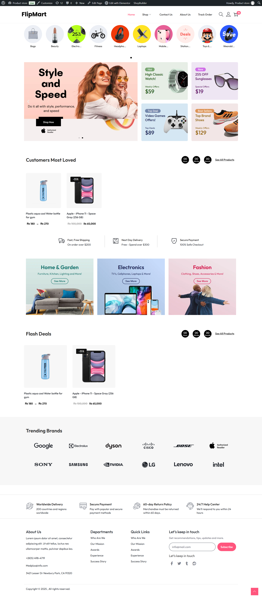
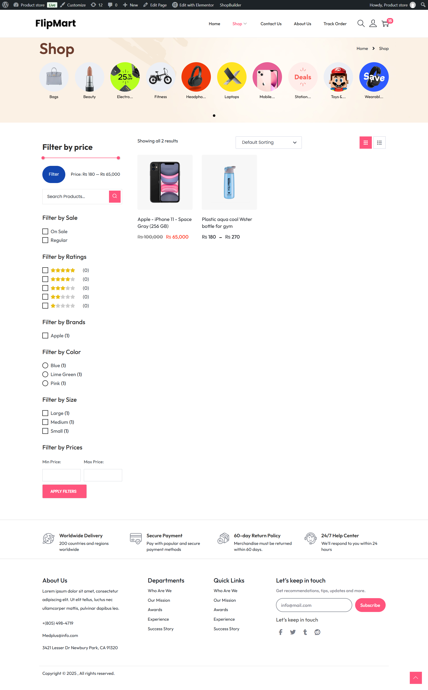
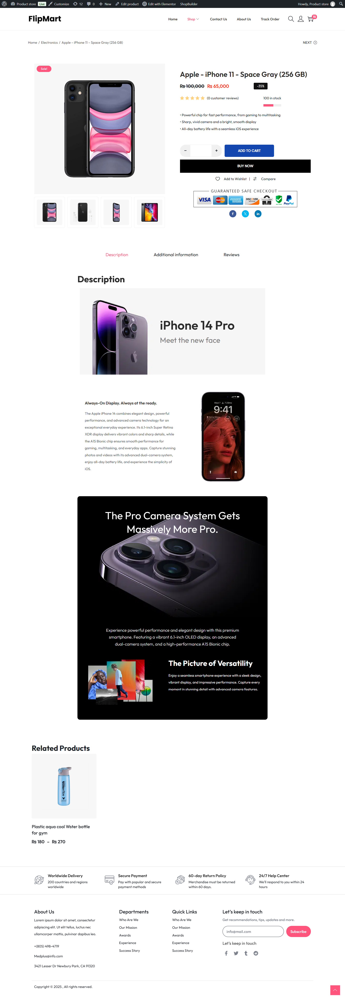
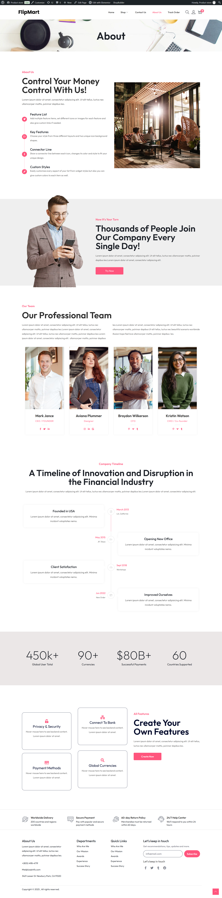

# 🛍️ FlipMart – WordPress E-Commerce Website

**FlipMart** is a responsive e-commerce website developed using WordPress and WooCommerce. The project demonstrates the design and development of an online shopping store, including product listings, shopping functionality, and a user-friendly interface.

This repository contains the WordPress website files, themes, plugins, media uploads, and database backup required to run the complete website locally.

> **Important Notice:** This website is not currently hosted on a live server. However, recruiters, developers, and visitors can download the repository and set it up on their local environment to explore the actual website and verify the project.

---

## 📸 Website Screenshots

The following screenshots showcase the website's design and functionality.

### Homepage


### Shop Page


### Single Product Page


### About Us Page



---

## ✨ Features

- Modern and responsive e-commerce design
- Product listing and shopping pages
- Individual product detail pages
- WooCommerce integration
- Product categories and navigation
- Shopping cart functionality
- Product images and media management
- Customizable WordPress theme
- User-friendly website layout

---

## 🛠️ Technologies Used

| Technology | Purpose |
|---|---|
| WordPress | Website development |
| WooCommerce | E-commerce functionality |
| Elementor | Page design and customization |
| HTML5 | Website structure |
| CSS3 | Styling and layout |
| PHP | WordPress functionality |
| MySQL | Database management |
| LocalWP | Local development environment |

---

## 📂 Repository Structure

```text
flip-mart/
│
├── plugins/
│   └── WordPress plugins
│
├── themes/
│   └── Installed WordPress themes
│
├── uploads/
│   └── Website images and media
│
├── royal-backup-reset/
│   └── Backup/reset related files
│
├── woostify-stylesheet/
│   └── Woostify stylesheet files
│
├── index.php
│
├── local-20261108-170631.sql
│
├── screenshots/
│   └── Website screenshots
│
└── README.md
```

---

## 💻 How to Run This Website Locally

Since the website is not hosted online, follow these instructions to view the original website on your computer.

### Requirements

- [LocalWP](https://localwp.com/) or XAMPP
- [WordPress](https://wordpress.org/download/)
- A web browser
- Git (optional)

### Step 1: Download the Repository

Clone the repository using Git:

```bash
git clone https://github.com/Aqsa-javed8822/flip-mart.git
```

Alternatively, download the ZIP file using the green **Code** button on GitHub and extract it.

### Step 2: Create a Local WordPress Website

1. Open LocalWP.
2. Create a new WordPress site.
3. Choose a site name, such as `flip-mart`.
4. Complete the WordPress installation.
5. Open the site's folder using LocalWP.

### Step 3: Add the Website Files

Locate the WordPress installation directory.

Open:

```text
app/public/wp-content/
```

Copy the repository's corresponding folders into this directory:

- `plugins`
- `themes`
- `uploads`

Merge the folders if they already exist.

Make sure the theme, plugins, and uploaded media files are placed in their correct WordPress directories.

### Step 4: Import the Database

The repository includes the original MySQL database backup:

```text
local-20261108-170631.sql
```

To import it:

1. Open your LocalWP site's database using its database management option.
2. Open phpMyAdmin or another MySQL database management tool.
3. Select the database created for your local WordPress site.
4. Open the **Import** tab.
5. Select `local-20261108-170631.sql`.
6. Click **Import** and wait for the process to finish.

**Important:** Importing the backup replaces the contents of the selected database. Use a fresh local WordPress database rather than an existing database containing important information.

### Step 5: Configure the Website URL

After importing the database, check the `wp_options` table.

Update the following options to match your new LocalWP site URL:

- `siteurl`
- `home`

For example:

```text
http://flip-mart.local
```

If the database contains the original local domain in other settings or content, use WP-CLI's `search-replace` command to update the old domain to your new local domain. This also handles serialized WordPress data.

### Step 6: View the Website

1. Start your local WordPress site.
2. Open its local URL in your browser.
3. Visit the homepage and explore the website.
4. Navigate through the shop, product pages, and other available sections.

You can also access the WordPress dashboard by visiting:

```text
http://flip-mart.local/wp-admin/
```

Use the existing WordPress administrator credentials if available. Otherwise, reset the administrator password through WP-CLI.

---

## 👩‍💻 Project Purpose

This project was developed as part of my web development learning and portfolio-building journey.

It demonstrates my practical experience with WordPress website development, WooCommerce, Elementor, theme customization, plugin integration, and database management.

The project represents my ability to build and configure a functional e-commerce website using WordPress.

---

## 👩‍💻 Developer

**Aqsa Javed**

Aspiring WordPress Developer | Web Designer

- GitHub: [Aqsa-javed8822](https://github.com/Aqsa-javed8822)
- Project Repository: [FlipMart](https://github.com/Aqsa-javed8822/flip-mart)

---

⭐ If you find this project interesting, feel free to explore the repository and run it locally to experience the website.
